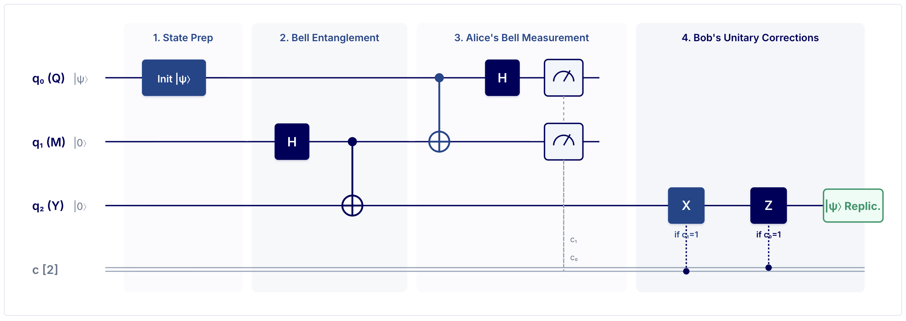
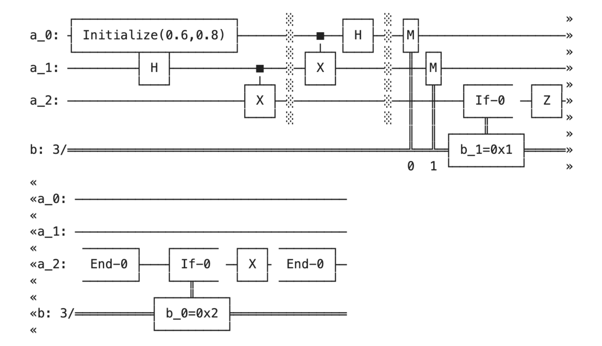

# Quantum Teleportation — From Alice to Bob
### Interactive Educational Simulator & Real IBM Quantum Hardware Telemetry

> An interactive quantum application built for the **IBM Qiskit Fall Fest 2026 at RV University**. Powered by **React**, **FastAPI**, **Qiskit**, and **Qiskit Aer**, with live integration to physical IBM Quantum QPUs (`ibm_kingston`, `ibm_marrakesh`, `ibm_fez`).

---

## 🌐 Live Web Application

The interactive platform is fully deployed and accessible from any desktop, tablet, or mobile browser worldwide:

### 👉 **[https://quantum-teleportation-qae8.onrender.com/](https://quantum-teleportation-qae8.onrender.com/)**

- **Instant Cloud Access:** No Python, Node.js, or local installation required.
- **Full Capabilities:** Includes interactive 3D Bloch sphere, 7-stage protocol walkthrough, multi-shot Aer simulator, hardware noise sweep, and live IBM Cloud Quantum telemetry.

---

## 👥 Team Members
- **Mohammed Ismail** 1RVU23CSE280 ([@mohammedismailmi](https://github.com/mohammedismailmi)) — *Project Developer* 

---

## 🎥 Video Presentation & Walkthrough

A complete, comprehensive video presentation explaining the theoretical physics, circuit architecture, mathematical proofs, and live simulator demonstration is available directly in the repository:

### 🎬 **[▶️ QT Presentation.mp4](https://drive.google.com/file/d/1V0f7Lv0dZylpS_gmTPDzRp46qwBCvG0R/view?usp=sharing)**
- **Title:** Presentation & Live Demo (Google Drive link)

---

## 🔬 Problem & Concept

### The Quantum Challenge
In classical computing, copying data is trivial. In quantum information theory, the **No-Cloning Theorem** (Wootters & Zurek, 1982) proves that an unknown, arbitrary pure quantum state cannot be duplicated:

$$\mathcal{U}_{\text{clone}} |\psi\rangle |0\rangle \ne |\psi\rangle |\psi\rangle$$

Furthermore, quantum states cannot be directly measured without irreversibly collapsing their wavefunctions, destroying the superposition and phase information.

### The Solution: Quantum Teleportation Protocol
Discovered by Bennett, Brassard, Crépeau, Jozsa, Peres, and Wootters (1993), quantum teleportation disassembles an arbitrary message qubit $|\psi\rangle = \alpha|0\rangle + \beta|1\rangle$ using:
1. **1 Shared Bell State (EPR Entanglement)**: $|\Phi^+\rangle_{MY} = \frac{1}{\sqrt{2}}(|00\rangle + |11\rangle)$ shared between Alice (qubit $M$) and Bob (qubit $Y$).
2. **Bell Basis Joint Measurement**: Alice applies a CNOT gate from message qubit $Q$ to $M$, followed by a Hadamard on $Q$, and measures both qubits in the computational basis.
3. **2 Classical Bits of Communication**: Alice transmits classical bits $(c_0, c_1)$ to Bob over an ordinary channel (obeying relativistic causality, $v \le c$).
4. **Feed-Forward Unitary Pauli Correction**: Bob applies $U = Z^{c_0} X^{c_1}$ to his qubit $Y$, deterministically restoring Alice's original state with **100% mathematical fidelity**:

| Alice's Measurement $(c_0, c_1)$ | Bell Projection | Bob's Collapsed State | Bob's Pauli Correction $U$ | Final State $|\psi\rangle_Y$ |
--
| **`00`** | $|\Phi^+\rangle = \frac{\|00\rangle + \|11\rangle}{\sqrt{2}}$ | $\alpha\|0\rangle + \beta\|1\rangle$ | $I$ (Identity) | $\alpha\|0\rangle + \beta\|1\rangle$ |
--
| **`01`** | $|\Psi^+\rangle = \frac{\|01\rangle + \|10\rangle}{\sqrt{2}}$ | $\beta\|0\rangle + \alpha\|1\rangle$ | $X$ (Bit-flip) | $\alpha\|0\rangle + \beta\|1\rangle$ |
--
| **`10`** | $|\Phi^-\rangle = \frac{\|00\rangle - \|11\rangle}{\sqrt{2}}$ | $\alpha\|0\rangle - \beta\|1\rangle$ | $Z$ (Phase-flip) | $\alpha\|0\rangle + \beta\|1\rangle$ |
--
| **`11`** | $|\Psi^-\rangle = \frac{\|01\rangle - \|10\rangle}{\sqrt{2}}$ | $\beta\|0\rangle - \alpha\|1\rangle$ | $XZ$ (Bit & Phase) | $\alpha\|0\rangle + \beta\|1\rangle$ |
--

---

## 🛠️ Setup & Installation

### Prerequisites
- **Python**: Version `3.10` or higher
- **Node.js**: Version `18.0` or higher (with `npm`)
- **Git**

### Installation Steps

1. **Clone the repository:**
   ```bash
   git clone https://github.com/mohammedismailmi/quantum-teleportation.git
   cd quantum-teleportation
   ```

2. **Set up Python Virtual Environment:**
   ```bash
   python3 -m venv .venv
   source .venv/bin/activate
   pip install --upgrade pip
   pip install -r requirements.txt
   ```

3. **Install Frontend Dependencies:**
   ```bash
   cd frontend
   npm install
   npm run build
   cd ..
   ```

---

## 🚀 How to Run the Code

### 1. Launch the Full-Stack Application (Recommended)
Start the FastAPI server, which hosts both the computational API and the compiled React production SPA:
```bash
source .venv/bin/activate
uvicorn server:app --host 127.0.0.1 --port 8000 --reload
```
Open **[http://localhost:8000](http://localhost:8000)** in your browser.

### 2. Run the Vite Frontend in Development Mode (Hot-Reload)
In a separate terminal window:
```bash
cd frontend
npm run dev
```
Open **[http://localhost:5173](http://localhost:5173)** with Hot Module Replacement (HMR).

### 3. Run the Quantum Verification Engine via CLI
To run the automated verification suite across all 8 cardinal states directly in the terminal:
```bash
source .venv/bin/activate
python quantum_teleportation.py
```

### 4. Query Live IBM Quantum Cloud QPUs via CLI
Check live operational status, qubit counts, and queue depth across physical IBM QPUs:
```bash
python quantum_teleportation.py --cloud
```

### 5. Submit Circuit to Real Physical IBM Quantum Hardware via CLI
Transpile and dispatch the quantum teleportation circuit directly to `ibm_kingston` (156-qubit Heron r2):
```bash
python quantum_teleportation.py --submit
# Or specify a different backend:
python quantum_teleportation.py --submit --backend=ibm_marrakesh
```

### 6. View Your Recent IBM Quantum Cloud Jobs via CLI
Fetch the status, backend, and creation timestamps of your cloud jobs:
```bash
python quantum_teleportation.py --jobs
```

### 7. Run the Automated Unit Test Suite
Execute all 29 verification and fidelity tests:
```bash
python -m pytest tests/test_teleportation.py -v
```

---

## Circuit




---

## 📊 Short Explanation of the Output

When you interact with the simulator or CLI, here is what each output section represents:

1. **Interactive 3D Bloch Sphere & State Coordinates**:
   - Outputs the exact 3-dimensional Cartesian projection $[x, y, z]$ and spherical angles $(\theta, \phi)$ of Alice's state vector $|\psi\rangle_Q$ on the unit Bloch sphere.
   - Displays real-time measurement probability bars: $P(|0\rangle) = |\alpha|^2$ and $P(|1\rangle) = |\beta|^2$.

2. **Step-by-Step Protocol Walkthrough (Stages 0–6)**:
   - Tracks the joint 3-qubit statevector $(Q \otimes M \otimes Y)$ across 7 sequential stages.
   - Outputs mathematical Dirac bra-ket equations, reduced density matrices $\rho_Q, \rho_M, \rho_Y$, and purity metrics ($Tr(\rho^2) = 1$ for pure states vs $Tr(\rho^2) = 0.5$ for maximally entangled subsystems).

3. **4-Outcome Measurement Decoder**:
   - Visualizes each of the 4 probabilistic branches (`00`, `01`, `10`, `11`).
   - Displays Bob's intermediate distorted state and the applied Pauli operator, proving state overlap fidelity $\mathcal{F} = |\langle\psi|\psi_Y\rangle|^2 = 1.000000$ (100.0%) for every branch.

4. **Qiskit Aer Multi-Shot Simulation Histogram**:
   - Executes the complete circuit using `AerSimulator` across 512 to 8,192 shots.
   - Outputs a 4-bin histogram showing measured counts and empirical probabilities converging to the theoretical $25\%$ uniform distribution.
   - Computes a $\chi^2$ (chi-square) goodness-of-fit metric confirming that variance is purely due to quantum shot noise ($\propto 1/\sqrt{N}$).

5. **Realistic Hardware Noise & `ibm_kingston` Calibration Curve**:
   - Simulates depolarizing noise ($\mathcal{E}_p(\rho)$) and thermal relaxation across error rates from $0\%$ to $20\%$.
   - Incorporates actual calibration data from the physical 156-qubit **Heron r2** processor (`ibm_kingston`):
     - $T_1$ relaxation time: $232.01\ \mu\text{s}$
     - $T_2$ dephasing time: $136.34\ \mu\text{s}$
     - 2Q (CZ) gate error: $0.196\%$
     - Readout error: $0.995\%$
     - Expected realistic QPU fidelity: $\approx 99.41\%$.

6. **Live IBM Quantum Cloud Telemetry & Job Dispatch**:
   - Connects live to IBM Cloud Quantum Platform using `qiskit-ibm-runtime`.
   - Displays real-time queue depth (e.g. `ibm_kingston: 4 pending jobs`).
   - Allows users to transpile circuits into native Heron dynamic basis gates (`cz, rz, sx, x`) and dispatch workloads directly to physical QPUs via `SamplerV2`.

---

## 📁 Repository Structure

```
quantum-teleportation/
├── QT Presentation.mp4            # Full 12m 38s video walkthrough & presentation (1080p)
├── quantum_teleportation.py       # Core quantum engine, math & IBM Cloud QPU integration
├── server.py                      # FastAPI REST server & SPA static file router
├── visualizations.py              # Classical plotting and Bloch sphere helpers
├── Dockerfile                     # Multi-stage production container build
├── render.yaml                    # One-click cloud deployment blueprint
├── entrypoint.sh                  # OpenMP TLS preloader for Qiskit Aer
├── requirements.txt               # Python package dependencies
├── README.md                      # Comprehensive project documentation
├── tests/
│   └── test_teleportation.py      # Automated test suite (36 unit tests)
└── frontend/                      # Responsive React + Vite application
    ├── index.html                 # Academic HTML shell with KaTeX stylesheets
    ├── vite.config.js             # Vite configuration with API proxy
    ├── package.json               # Node.js dependencies
    └── src/
        ├── App.jsx                # Main application component & state manager
        ├── index.css              # Formal publication design system (b1: #1B468C, b2: #00005D)
        └── components/
            ├── Header.jsx                 # Formal top navigation bar (zero logos)
            ├── StatePreparationPanel.jsx  # Complex amplitudes & angle controls
            ├── BlochSphere3D.jsx          # Interactive 3D HTML5 Canvas Bloch sphere
            ├── ProtocolWalkthrough.jsx    # 7-stage step-by-step visualizer
            ├── MeasurementMatrix.jsx      # 4-branch Pauli correction decoder
            ├── AerSimulatorView.jsx       # Multi-shot Aer histogram & chi-square stats
            ├── NoiseAnalysisView.jsx      # Hardware noise sweep & Heron r2 calibration
            ├── CircuitDiagramView.jsx     # Interactive SVG circuit & Qiskit code exporter
            ├── VerificationSuiteView.jsx  # 8-state automated audit harness
            ├── TheoryMathView.jsx         # Mathematical derivations & no-cloning proofs
            ├── IBMCloudLiveView.jsx       # Live IBM Cloud QPU queue & hardware dispatch
            └── KatexView.jsx              # KaTeX LaTeX renderer (HTML-only mode)
```

---

## ⚠️ Limitations & What I Learned

### Limitations
- **Hardware noise:** On `ibm_kingston` (1024 shots) the four outcomes were not the ideal ~256 each. Counts ranged from 156 (`00`) to 396 (`11`), while the Aer simulator converges to ~25% per outcome. Gate errors, readout errors and decoherence on a real QPU cause this gap.
- **Simulator is not hardware:** Aer results are noise-free unless a noise model is added. The noise sweep and the `ibm_kingston` calibration values (T1 ≈ 232 µs, T2 ≈ 136 µs, CZ error ≈ 0.196%, readout error ≈ 0.995%) only approximate real behaviour.
- **Small experiment:** Hardware results come from a single 1024-shot job. Repeated runs and error mitigation would give a stronger comparison.
- **One qubit, not a network:** This teleports one qubit between two neighbouring qubits on the same chip, not across a real distance.

### What I Learned
- Teleportation transfers a quantum state without copying it. This is consistent with the no-cloning theorem. The state is destroyed on Alice's side, and only 2 classical bits are sent.
- The protocol works only when Bob applies the correct Pauli correction (`I`, `X`, `Z` or `XZ`) for Alice's measurement result. In the simulator this gives fidelity 1.0 for every branch.
- The circuit that runs on hardware looks very different from the textbook one. Transpilation into native gates (`cz`, `rz`, `sx`, `x`) and mid-circuit measurement with conditional corrections (feed-forward) are needed.
- Ideal simulation and real hardware can differ a lot, so results from the two must always be labelled separately.

### What I Would Improve Next
- Run more shots and repeat on several backends (`ibm_fez`, `ibm_marrakesh`).
- Add error mitigation and compare mitigated vs. raw hardware results.
- Measure the output state fidelity on hardware instead of only checking the outcome counts.

---

## 📜 References & Acknowledgements

1. **Bennett, C. H., et al.** (1993). *Teleporting an unknown quantum state via dual classical and Einstein-Podolsky-Rosen channels*. Physical Review Letters, 70(13), 1895.
2. **Wootters, W. K., & Zurek, W. H.** (1982). *A single quantum cannot be cloned*. Nature, 299(5886), 802–803.
3. **Nielsen, M. A., & Chuang, I. L.** (2010). *Quantum Computation and Quantum Information*. Cambridge University Press.
4. **IBM Quantum & Qiskit Documentation** — [docs.quantum.ibm.com](https://docs.quantum.ibm.com/)
5. **IBM Qiskit Fall Fest 2026** at RV University.
